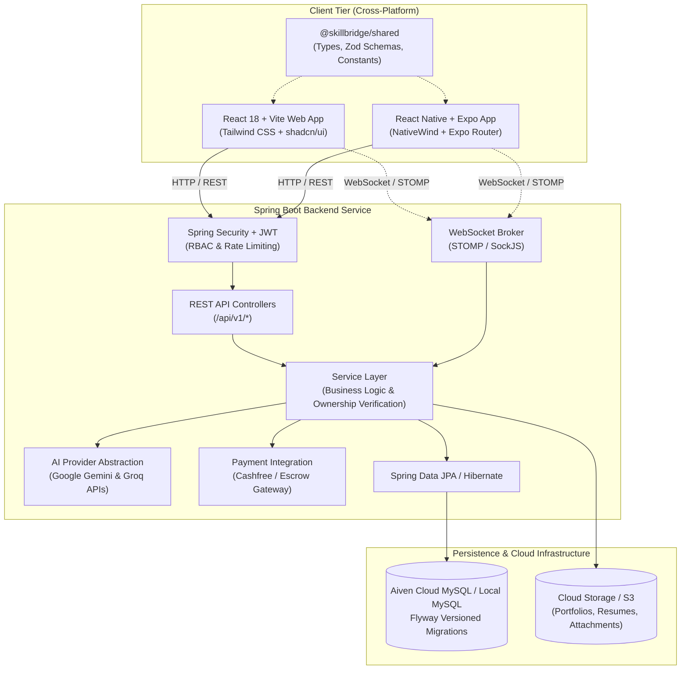

<div align="center">

# 🌉 SkillBridge

### **Next-Generation AI-Powered Freelancing & Talent Marketplace**
*"Where Talent Meets Opportunity."*

[](https://www.oracle.com/java/)
[](https://spring.io/projects/spring-boot)
[](https://react.dev/)
[](https://www.typescriptlang.org/)
[](https://vitejs.dev/)
[](https://tailwindcss.com/)
[](https://expo.dev/)
[](https://www.mysql.com/)
[](LICENSE)
[]()
[]()

<br />

[Explore Architecture](#-system-architecture) •
[Daily Progress Log](#-daily-engineering-log--sprint-tracker) •
[Quick Start](#-quick-start-guide) •
[Tech Stack](#-technology-stack) •
[Roadmap](#-implementation-roadmap) •
[API Reference](#-api-specification-snapshot)

</div>

---

## 📌 Executive Overview

**SkillBridge** is an enterprise-grade, cross-platform freelancing ecosystem and talent marketplace. Built to address common inefficiencies in modern gig-economy platforms (such as high fees, opaque matching algorithms, payment disputes, and rampant fraud), SkillBridge integrates **explainable AI talent matching**, **milestone-based escrow contracts**, **dedicated project workspaces with Kanban tracking**, and **real-time WebSocket collaboration**.

The platform is designed and engineered for three core user roles across **Web**, **Android**, and **iOS**:
1. **Clients (Businesses & Recruiters):** Job scoping, AI job description generation, verified candidate shortlisting, milestone management, and contract disbursements.
2. **Freelancers (Independent Talent):** Verified portfolios, skill-matched project feeds, automated proposal drafts, milestone execution workspaces, and instant payouts.
3. **Administrators (Platform Operators):** Governance, dispute arbitration, AI-powered fraud/scam detection, and real-time revenue analytics.

---

## 📅 Daily Engineering Log & Sprint Tracker

> **Notice:** This section is updated daily to track technical accomplishments, verification results, and immediate next steps throughout development.

### 🎯 Current Sprint Status
- **Current Phase:** `Phase 1: Design System & Frontend Foundation`
- **Active Branch:** `development`
- **Last Verified Date:** `2026-11-03`
- **System Health:** 🟢 Backend Tests Passing (100%) · 🟢 Shared Types Built · 🟢 Web Production Build Verified

### 📝 Daily Progress History

| Date | Phase | Technical Accomplishments | Tests & Verification | Next Priority |
|:---:|:---:|---|:---:|---|
| **2026-11-03** | **Phase 0** | • Full repository audit & dependency baseline established.<br>• Root `.gitignore`, `LICENSE` (MIT), and `.env.example` created.<br>• Spring Boot backend configured with multi-profile properties (`dev` with H2 fallback, `prod` with Aiven MySQL).<br>• Layered package hierarchy created (`config`, `controller`, `dto`, `entity`, `exception`, `integration`, `mapper`, `repository`, `security`, `service`, `util`, `validation`, `websocket`).<br>• Initial `HealthCheckController`, `ApiResponse<T>`, `GlobalExceptionHandler`, and `SecurityConfig` (CORS + permitAll for dev).<br>• Shared TypeScript workspace `@skillbridge/shared` implemented with models, constants, Zod schemas, and utilities.<br>• Web frontend scaffolded with React 18, Vite, TypeScript, Tailwind CSS, Lucide icons, responsive Navbar, Footer, and Landing Hero.<br>• Mobile app scaffolded with Expo SDK 52, Expo Router, group layouts, and splash welcome screen. | • `./gradlew test`: **PASSED (100%)**<br>• `@skillbridge/shared`: **Compiled (.d.ts + .js)**<br>• `@skillbridge/web`: **`tsc -b && vite build` (4.24s, 0 errors)** | **Phase 1:** Comprehensive design system components (shadcn/ui), responsive dashboard shells, and mobile onboarding navigation. |

---

## 🏗️ System Architecture

SkillBridge adopts a decoupled client-server architecture powered by a high-throughput Spring Boot REST and WebSocket API, unified by isomorphic TypeScript domain models.



---

## 💻 Technology Stack

### Frontend Web
| Layer | Technologies |
|---|---|
| **Core Framework** | React 18, TypeScript, Vite 6 |
| **Styling & Design System** | Tailwind CSS 3.4, PostCSS, Autoprefixer |
| **Component Primitives** | shadcn/ui patterns, Lucide React, class-variance-authority (`clsx` + `tailwind-merge`) |
| **State & Server Cache** | TanStack Query (React Query v5) |
| **Forms & Validation** | React Hook Form, Zod |
| **Routing** | React Router DOM v6 |
| **Charts & Metrics** | Recharts |

### Frontend Mobile
| Layer | Technologies |
|---|---|
| **Core Framework** | React Native 0.76, Expo SDK 52, TypeScript |
| **Navigation** | Expo Router (File-based routing with nested stack/tab layouts) |
| **Styling** | NativeWind / StyleSheet with shared theme tokens |
| **State & Cache** | TanStack Query v5 |
| **Forms & Validation** | React Hook Form, Zod |

### Shared Workspace (`packages/shared`)
| Component | Details |
|---|---|
| **Language** | TypeScript 5.7 (Target ES2022) |
| **Domain Models** | Unified User, Project, Proposal, Contract, Milestone, and Task interfaces |
| **Validation Schemas** | Zod schemas for runtime payload validation on client and server |
| **Design Tokens** | Brand palette (`#5146E5` Deep Indigo, `#8067F5` Purple, `#F8F9FC` Background), typography, and categories |

### Backend API
| Layer | Technologies |
|---|---|
| **Runtime & Framework** | Java 17 LTS, Spring Boot 4.1.2, Gradle 9.8.2 |
| **Web & REST** | Spring Web MVC, Spring Boot Actuator |
| **Security** | Spring Security, JJWT (Access + Refresh Token rotation), BCrypt |
| **Persistence & ORM** | Spring Data JPA, Hibernate, MySQL Connector/J |
| **Database Migrations** | Flyway Core & Flyway MySQL |
| **Real-Time Messaging** | Spring WebSocket (STOMP protocol) |
| **AI Integration** | Spring AI, Google Gemini API, Groq Cloud API |
| **Testing** | JUnit 5, Mockito, Spring Boot Test, H2 In-Memory DB |

---

## 📂 Repository Directory Layout

```
SkillBridge/
│
├── backend/                                # Spring Boot Java Application
│   ├── src/
│   │   ├── main/
│   │   │   ├── java/com/skillbridge/
│   │   │   │   ├── config/                 # Security, WebMvc, WebSocket configs
│   │   │   │   ├── controller/             # REST API Controllers (/api/v1)
│   │   │   │   ├── service/                # Business logic services
│   │   │   │   ├── repository/             # Spring Data JPA repositories
│   │   │   │   ├── entity/                 # Relational database entities
│   │   │   │   ├── dto/                    # Request & Response Data Transfer Objects
│   │   │   │   ├── mapper/                 # Entity <-> DTO converters
│   │   │   │   ├── security/               # JWT filter, token provider, RBAC
│   │   │   │   ├── exception/              # Global exception handler & error envelopes
│   │   │   │   ├── validation/             # Custom bean validation annotations
│   │   │   │   ├── integration/            # AI, Payment, Storage adapters
│   │   │   │   ├── websocket/              # WebSocket STOMP handlers & message models
│   │   │   │   └── SkillbridgeApplication.java # Spring Boot Entry Point
│   │   │   │
│   │   │   └── resources/
│   │   │       ├── application.properties      # Base configuration & actuator
│   │   │       ├── application-dev.properties  # Development profile (H2 fallback)
│   │   │       ├── application-prod.properties # Production profile (Aiven MySQL)
│   │   │       └── db/migration/               # Flyway SQL migrations (V1__init.sql...)
│   │   │
│   │   └── test/                           # JUnit 5 & MockMvc integration tests
│   │
│   ├── build.gradle                        # Gradle build configuration
│   ├── gradlew / gradlew.bat               # Gradle wrapper executable
│   └── settings.gradle                     # Project name definition
│
├── frontend/
│   ├── web/                                # React 18 + Vite Web Application
│   │   ├── public/                         # Public static assets & favicon
│   │   ├── src/
│   │   │   ├── assets/                     # Visual assets & illustrations
│   │   │   ├── components/                 # shadcn/ui & common components
│   │   │   ├── layouts/                    # Layout wrappers (Auth, Dashboard, Public)
│   │   │   ├── pages/                      # Landing, Auth, Freelancer, Client, Admin
│   │   │   ├── hooks/                      # Custom React hooks (auth, query, responsive)
│   │   │   ├── services/                   # Axios API client & endpoints
│   │   │   ├── context/                    # AuthContext, NotificationContext
│   │   │   ├── utils/                      # Helper functions (`cn`, formatting)
│   │   │   ├── App.tsx                     # Top-level router & query client
│   │   │   └── main.tsx                    # React DOM entry point
│   │   ├── package.json
│   │   ├── tailwind.config.js
│   │   └── vite.config.ts
│   │
│   └── mobile/                             # React Native + Expo Application
│       ├── app/                            # Expo Router file-based navigation
│       │   ├── _layout.tsx                 # Root layout & providers
│       │   ├── index.tsx                   # Splash / Welcome screen
│       │   ├── (auth)/                     # Auth stack (Login, Register)
│       │   ├── (freelancer)/               # Freelancer tab navigation
│       │   ├── (client)/                   # Client tab navigation
│       │   └── (admin)/                    # Admin console navigation
│       ├── constants/theme.ts              # Shared theme palette & typography
│       ├── app.json                        # Expo app metadata & splash config
│       └── package.json
│
├── packages/
│   └── shared/                             # Shared TypeScript Workspace
│       ├── src/
│       │   ├── types/                      # Domain interfaces & enum types
│       │   ├── constants/                  # Color tokens, categories, skills
│       │   ├── schemas/                    # Zod validation schemas
│       │   ├── utils/                      # Formatters, helpers, badge calculators
│       │   └── index.ts                    # Root package barrel export
│       ├── package.json
│       └── tsconfig.json
│
├── docs/                                   # Architecture & Design Documentation
│   ├── architecture/                       # System blueprints & sequence diagrams
│   ├── database/                           # Schema designs & normalization notes
│   ├── api/                                # REST API & WebSocket specifications
│   └── project-planning/                   # Phase roadmaps & milestone tracking
│
├── .env.example                            # Master environment template
├── .gitignore                              # Comprehensive multi-stack ignore rules
├── LICENSE                                 # MIT Open Source License
└── README.md                               # Project documentation hub
```

---

## ⚡ Quick Start Guide

### Prerequisites
Ensure your local development machine has the following tools installed:
- **Java Development Kit (JDK):** Version 17 LTS (Oracle or OpenJDK)
- **Node.js:** v20.x or v24.x LTS
- **npm:** v10+ (included with Node.js)
- **Git**
- *(Optional)* **MySQL:** Version 8.0+ (or an active [Aiven Cloud MySQL](https://aiven.io/) instance)

---

### Step 1: Environment Variables Setup
Copy the sample environment file to configure your local keys:
```bash
# Clone the repository
git clone https://github.com/gondchawarswaraj45/SkillBridge.git
cd SkillBridge

# Create your local environment configuration
cp .env.example .env
```

---

### Step 2: Build the Shared Workspace
The shared package contains TypeScript types and Zod schemas imported by both Web and Mobile frontends:
```bash
cd packages/shared
npm install
npm run build
cd ../..
```

---

### Step 3: Run the Spring Boot Backend
The backend defaults to the `dev` profile with an in-memory H2 database if no MySQL credentials are provided, allowing instant startup:
```bash
cd backend

# Run the test suite (verifies Spring context & API controllers)
./gradlew test

# Start the Spring Boot server
./gradlew bootRun
```
* Backend API Base URL: `http://localhost:8080/api/v1`
* Health Check Endpoint: `http://localhost:8080/api/v1/health`
* Spring Boot Actuator: `http://localhost:8080/actuator/health`
* In-Memory H2 Console (Dev): `http://localhost:8080/h2-console` *(JDBC URL: `jdbc:h2:mem:skillbridge_dev`)*

---

### Step 4: Run the Web Application
```bash
cd frontend/web

# Install web dependencies
npm install

# Start Vite development server
npm run dev
```
Open your browser and navigate to `http://localhost:5173`.

---

### Step 5: Run the Mobile Application (Expo)
```bash
cd frontend/mobile

# Install mobile dependencies
npm install

# Start Expo development server
npx expo start
```
* Press `a` to launch on Android Emulator
* Press `i` to launch on iOS Simulator
* Scan the displayed QR code with the **Expo Go** app on your physical smartphone

---

## 🎯 Feature Matrix by Role

| Feature | Description | Freelancer | Client | Admin | Status |
|---|---|:---:|:---:|:---:|:---:|
| **Authentication & RBAC** | BCrypt hashing, JWT access/refresh rotation, email verification | ✅ | ✅ | ✅ | Phase 2 |
| **Profile Management** | Portfolios, verified skills, GitHub/LinkedIn links, resume upload | ✅ | ✅ | — | Phase 3 |
| **Marketplace & Search** | Filter jobs by budget, skills, duration, experience level | ✅ | ✅ | — | Phase 4 |
| **AI Talent Matching** | Compatibility scoring based on skills, portfolio, and past feedback | ✅ | ✅ | — | Phase 7 |
| **Proposal Workflow** | Cover letters, custom milestone estimates, client shortlisting | ✅ | ✅ | — | Phase 4 |
| **Project Workspace** | Kanban boards (To Do, In Progress, In Review, Done), file sharing | ✅ | ✅ | — | Phase 5 |
| **Milestone Escrow** | Secure client funding held in escrow; released upon deliverable approval | ✅ | ✅ | — | Phase 8 |
| **Real-Time Messaging** | WebSocket chat, typing indicators, read receipts, attachments | ✅ | ✅ | — | Phase 6 |
| **AI Resume Analyzer** | Automated scoring, skill gap detection, and improvement suggestions | ✅ | — | — | Phase 7 |
| **AI Project Scoper** | Smart job description and milestone generator for clients | — | ✅ | — | Phase 7 |
| **AI Scam Detection** | Machine learning analysis of suspicious job postings & payment evasion | — | — | ✅ | Phase 7 |
| **Admin Analytics** | Revenue statistics, dispute resolution queue, user moderation | — | — | ✅ | Phase 9 |

---

## 📡 API Specification Snapshot

All REST endpoints return a unified response envelope:

#### Successful Response (`200 OK / 201 Created`)
```json
{
  "success": true,
  "message": "Operation completed successfully",
  "data": { ... },
  "timestamp": "2026-11-03T01:35:00Z"
}
```

#### Error Response (`400 Bad Request / 403 Forbidden / 500 Internal`)
```json
{
  "success": false,
  "message": "Validation failed",
  "data": {
    "email": "Please enter a valid email address"
  },
  "timestamp": "2026-11-03T01:35:00Z"
}
```

### Core API Route Groups
| Endpoint Prefix | Description | Auth Required |
|---|---|:---:|
| `/api/v1/health` | Service health status and system telemetry | No |
| `/api/v1/auth/*` | Registration, login, token refresh, email verification | No |
| `/api/v1/freelancers/*` | Profile details, skills index, portfolio showcases | Role-based |
| `/api/v1/clients/*` | Company profile, posted jobs, spending statistics | Role-based |
| `/api/v1/projects/*` | Job posting, search marketplace, candidate shortlisting | Role-based |
| `/api/v1/proposals/*` | Proposal submissions, milestone proposals, acceptances | Role-based |
| `/api/v1/contracts/*` | Contract lifecycle, milestone submissions, deliverable approvals | Role-based |
| `/api/v1/tasks/*` | Kanban board tasks, assignees, priorities, and deadlines | Role-based |
| `/api/v1/conversations/*` | Chat history, unread counts, direct messaging | Yes |
| `/api/v1/ai/*` | Talent matching, resume parsing, description generator, fraud audit | Yes |
| `/api/v1/payments/*` | Escrow deposits, milestone releases, invoice generation | Yes |
| `/api/v1/admin/*` | User suspensions, dispute arbitration, financial metrics | Admin only |

---

## 🗺️ Implementation Roadmap

```
[Phase 0: Setup] ──────► [Phase 1: Design System] ──────► [Phase 2: Auth & RBAC]
       │                                                         │
       ▼                                                         ▼
[Phase 3: Profiles] ────► [Phase 4: Marketplace] ────────► [Phase 5: Workspaces]
       │                                                         │
       ▼                                                         ▼
[Phase 6: Real-Time] ───► [Phase 7: AI Engine] ──────────► [Phase 8: Escrow Payments]
       │                                                         │
       ▼                                                         ▼
[Phase 9: Admin] ───────► [Phase 10: Mobile Native] ─────► [Phase 11: Production Deploy]
```

- [x] **Phase 0: Project Setup & Environment Baseline**
  - [x] Repository audit, Java 17 / Gradle / Node.js verification
  - [x] Multi-profile backend setup (`dev` with H2, `prod` with MySQL)
  - [x] Shared TypeScript workspace `@skillbridge/shared`
  - [x] Scaffold React 18 + Vite web client & Expo mobile client
- [ ] **Phase 1: Design System & Frontend Foundation**
  - [ ] shadcn/ui components (Buttons, Inputs, Dialogs, Dropdowns, Badges, Tabs)
  - [ ] Polished Landing Page with interactive features and testimonials
  - [ ] Layout shells for Freelancer, Client, and Admin dashboards
  - [ ] Mobile onboarding screen flow and bottom-tab navigation structure
- [ ] **Phase 2: User Authentication & Onboarding**
- [ ] **Phase 3: User Profiles & Portfolio System**
- [ ] **Phase 4: Project Marketplace & Proposal Lifecycle**
- [ ] **Phase 5: Contracts, Milestones & Kanban Project Workspace**
- [ ] **Phase 6: Real-Time Messaging & Meeting Scheduling**
- [ ] **Phase 7: AI-Powered Features (Matching, Resume Scorer, Scoping, Fraud)**
- [ ] **Phase 8: Payment Gateway & Milestone Escrow Management**
- [ ] **Phase 9: Admin Dashboard, Moderation & Platform Analytics**
- [ ] **Phase 10: Mobile Native Optimization (Gestures, Push Notifications)**
- [ ] **Phase 11: Security Hardening, E2E Testing & Cloud Deployment**

---

## 🤝 Git Workflow & Coding Standards

To maintain clean history and high software engineering standards:

### Branching Convention
* `main`: Protected production branch (tagged releases only).
* `development`: Primary integration branch where daily updates land.
* `feature/<feature-name>`: Scoped branches for specific modules:
  * `feature/backend`
  * `feature/web-frontend`
  * `feature/mobile-app`
  * `feature/ai-integration`

### Commit Message Standard (Conventional Commits)
```
feat(auth): implement refresh token rotation mechanism
fix(chat): resolve message deduplication on reconnect
docs(readme): update daily engineering log for Phase 1
test(controller): add comprehensive test suite for HealthCheck
refactor(shared): extract project category constants
```

---

## 📄 License

This project is licensed under the **MIT License** — see the [LICENSE](LICENSE) file for complete details.

---

## 👨‍💻 Author & Maintainer

**Swaraj Bhosale**  
*Computer Engineering / Full Stack Developer*  
- **GitHub:** [@gondchawarswaraj45](https://github.com/gondchawarswaraj45) / [@swarajbhosale1](https://github.com/swarajbhosale1)
- **Project:** SkillBridge — Final Year Capstone & Portfolio System

<div align="center">
  <sub>SkillBridge is built with ❤️ for talent and clients worldwide.</sub>
</div>
